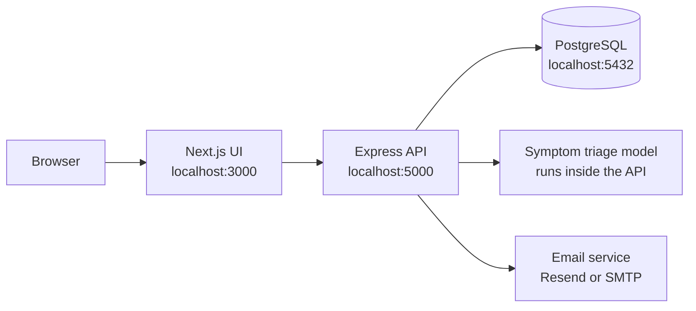

# MamaCare Web

MamaCare is a maternal-health web application. This repository contains a Next.js web client, an Express API, and a PostgreSQL database.

## How It Works



The normal request flow is:

1. The user opens the Next.js interface.
2. A page or form calls an endpoint on the Express API.
3. Express validates the request and checks authentication when required.
4. The relevant backend module reads or writes PostgreSQL.
5. The API returns JSON and the UI updates.

The only outside service is email delivery, used for verification and password reset codes. The symptom triage model is trained and runs inside the API, so no health data is sent to third-party AI services.

## Quick Start

### Prerequisites

- Node.js 20 or newer
- npm
- Docker Desktop for the local PostgreSQL database

Install dependencies from the repository root:

```powershell
npm install
```

### 1. Start the database

```powershell
docker compose up -d db
```

The local database uses these defaults:

| Setting | Value |
| --- | --- |
| Host | `localhost` |
| Port | `5432` |
| Database | `mamacare` |
| User | `postgres` |
| Password | `kevin123` |

The backend reads its connection from `server/.env` through `DATABASE_URL`.

### 2. Create the database schema

```powershell
npm run migrate
```

This applies the migrations in `server/migrations/` and creates the application tables, enums, indexes, and extensions. Run it again whenever you pull new migrations.

### 3. Start the backend

In a new terminal:

```powershell
npm run server
```

The Express API runs at `http://localhost:5000`. Check it with `http://localhost:5000/health`.

### 4. Start the frontend

In another terminal:

```powershell
npm run dev
```

Open `http://localhost:3000`. If port 3000 is occupied, Next.js prints the alternate port it selected.

## Three-Terminal Workflow

Keep these processes running during development:

```text
Terminal 1: docker compose up -d db
Terminal 2: npm run server
Terminal 3: npm run dev
```

When finished, stop the database with:

```powershell
docker compose down
```

Use `docker compose down -v` only for an intentional local database reset. It deletes the database volume and its data.

## Environment Configuration

Copy the example files and fill them in. Never commit the real files (they are git-ignored).

| File | Copy to | Used by |
| --- | --- | --- |
| `server/.env.example` | `server/.env` | Express API |
| `.env.example` | `.env.local` | Next.js website |

Every variable is explained in the example files. The essentials:

- `DATABASE_URL`: PostgreSQL connection string.
- `JWT_SECRET` and `JWT_REFRESH_SECRET`: two different random strings of at least 32 characters. **The API refuses to start without them.** Generate one with:

  ```powershell
  node -e "console.log(require('crypto').randomBytes(48).toString('hex'))"
  ```

- Email for verification and password reset codes: `RESEND_API_KEY` + `FROM_EMAIL` (recommended), or the `SMTP_*` variables. Locally, without either, codes are printed in the API terminal instead of emailed.
- `NEXT_PUBLIC_API_URL=http://localhost:5000` in `.env.local` so the website can reach the local API.

## Folder Guide

| Location | Responsibility |
| --- | --- |
| `app/` | Next.js pages, layouts and error pages |
| `components/` | Reusable frontend components |
| `lib/` | Shared frontend helpers: API address, data loading, types |
| `messages/` | Interface text in English (`en.json`) and Kinyarwanda (`rw.json`) |
| `i18n/` | Language setup (cookie-based English/Kinyarwanda switch) |
| `store/` | Client-side state, including authentication |
| `server/src/index.ts` | Starts the Express API |
| `server/src/app.ts` | Express app: security middleware and routes |
| `server/src/modules/` | Backend feature modules (controllers, models, routes) |
| `server/src/middleware/` | Authentication middleware |
| `server/src/triage/` | Symptom triage: training data, model, and evaluation |
| `server/src/db/` | PostgreSQL connection |
| `server/migrations/` | Versioned database schema changes |
| `server/tests/` | Automated tests |
| `server/scripts/` | Maintenance scripts (e.g. granting admin access) |
| `public/` | Static browser assets |

## API Map

- `/api/auth` - registration, email verification, login, logout, password reset, current user, profile settings
- `/api/symptoms/log` - symptom triage; open to everyone, saved to history only for logged-in users
- `/api/symptoms/history` - a logged-in user's saved symptom checks
- `/api/profile` - pregnancy profile (logged in)
- `/api/visits` - antenatal visits (logged in)
- `/api/contact` - contact form: stores the message and notifies the team by email
- `/api/admin` - admin area: statistics, user management, contact messages (admins only)
- `/health` - API health check

## Useful Commands

| Command | Purpose |
| --- | --- |
| `npm run dev` | Start the Next.js development server |
| `npm run server` | Start the Express API with `tsx` |
| `npm run migrate` | Apply pending database migrations (local, reads `server/.env`) |
| `npm test` | Run all automated tests (needs the database running and migrated) |
| `npm run triage:eval` | Measure the symptom triage model's accuracy and safety |
| `npm run admin:grant -- you@example.com` | Give an existing account admin access |
| `npx eslint .` | Lint the whole project |
| `npm run build` | Create a production website build |
| `npm run start` | Serve the production website build |
| `docker compose ps` | Check the database container |
| `docker compose logs db` | View database logs |

## Testing

`npm test` runs two suites:

- **Triage safety** (`server/tests/triage.test.ts`): emergency messages in English and Kinyarwanda must always be rated red.
- **API** (`server/tests/auth.test.ts`): sign-up, verification, login, password reset and symptom checks against a real database. No real emails are sent, and test accounts are deleted afterwards.

GitHub Actions (`.github/workflows/ci.yml`) runs lint, type-checks, the production build, migrations on a fresh database, and all tests on every push and pull request.

To improve the triage model, add example sentences to the right intent in `server/src/triage/intents.ts`, then run `npm run triage:eval` and `npm test`.

## Admin Area

Admins see an **Admin** link in the navigation bar (`/admin`) with:

- **Overview:** user counts, sign-ups per week, and symptom check results by urgency (totals only, no individual health records).
- **Users:** search, make or remove admin, deactivate or reactivate, and permanently delete an account with its health records (for data deletion requests).
- **Messages:** contact-form messages, with reply, mark as read and delete.

To create the first admin, sign up normally, then run `npm run admin:grant -- you@example.com` (on Render: in the service's Shell). Admins cannot remove their own admin access, and the last active admin cannot be removed. Role changes and deactivations take effect within 15 minutes.

## Translations

The interface supports English and Kinyarwanda, switched with the EN/RW buttons in the navigation bar (stored in the `NEXT_LOCALE` cookie).

- Interface text lives in `messages/en.json` and `messages/rw.json`. Any key missing from `rw.json` falls back to English, so pages can be translated gradually.
- Translated so far: navigation, sign-up, login, verification, password reset, the symptom checker, and the danger-sign sections of the prenatal, lactation and postpartum guides. Other pages are still English.
- The symptom checker's answers in Kinyarwanda are in `server/src/triage/responsesRw.ts`; a test fails if a topic has no Kinyarwanda answer.
- **All Kinyarwanda text is a draft and must be reviewed by a native-speaking health professional before launch.**

## Deployment

The API is defined in `render.yaml` (Render Blueprint). On every deploy Render installs dependencies, compiles the API, applies pending migrations (`npm run migrate:deploy`) and starts the server. Set `DATABASE_URL`, `RESEND_API_KEY` and `FROM_EMAIL` in the Render dashboard; the JWT secrets are generated by Render.

For the website, choose one of these setups:

1. **Forwarding (recommended, works on any host).** Deploy the Next.js app (Render, Vercel, ...) with `API_PROXY_URL` set to the API's URL and `NEXT_PUBLIC_API_URL` left empty. The website forwards `/api/*` to the API, so the browser talks to a single site and the login cookie works in every browser, including Safari on iPhone. Set `TRUST_PROXY=2` on the API.
2. **Same domain.** Website on `app.example.rw` and API on `api.example.rw`: set `NEXT_PUBLIC_API_URL` to the API's URL and `CORS_ORIGINS` on the API to the website's URL.

Avoid hosting the website and the API on two unrelated domains (for example `*.vercel.app` and `*.onrender.com`) without forwarding: browsers that block third-party cookies, such as Safari, will not keep users logged in.

## Troubleshooting

**Database connection fails**

Make sure Docker Desktop is running, the `db` container is up, and `DATABASE_URL` in `server/.env` matches the Compose values.

**Port 3000 or 5000 is already in use**

Next.js automatically chooses another frontend port. For the backend, stop the process using the port or set a different `PORT` in `server/.env`.

**Migration fails on an existing database**

Do not delete the volume if its data matters. Inspect the database first; `docker compose down -v` is a destructive local reset.

**The API exits with "Server configuration error"**

Set `DATABASE_URL`, `JWT_SECRET` and `JWT_REFRESH_SECRET` in `server/.env` as described in Environment Configuration.

**Verification or reset emails do not arrive**

Check the email variables in `server/.env` and the API terminal for `Mailer:` messages. Locally, the code is also printed in the API terminal.

**CI fails at "Install dependencies" with "package.json and package-lock.json are not in sync"**

npm on Windows can drop Linux-only optional packages from `package-lock.json` after `npm install`. Regenerate the lock file without installing, then commit it:

```powershell
Remove-Item package-lock.json; npm install --package-lock-only
npm ci --dry-run   # must succeed before you push
```
